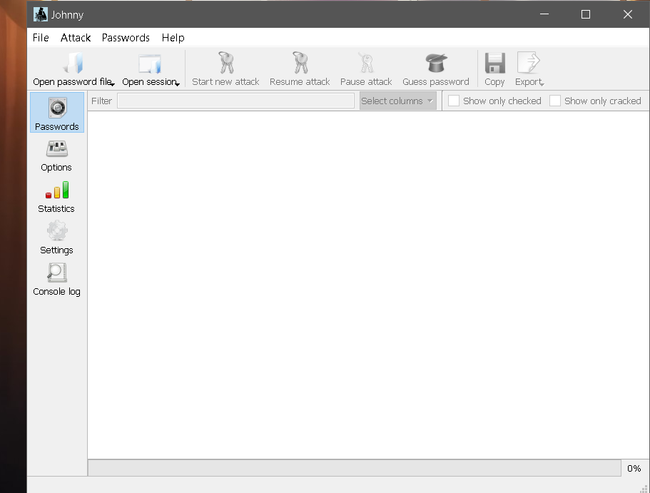
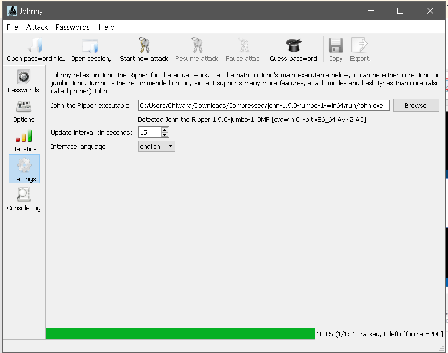
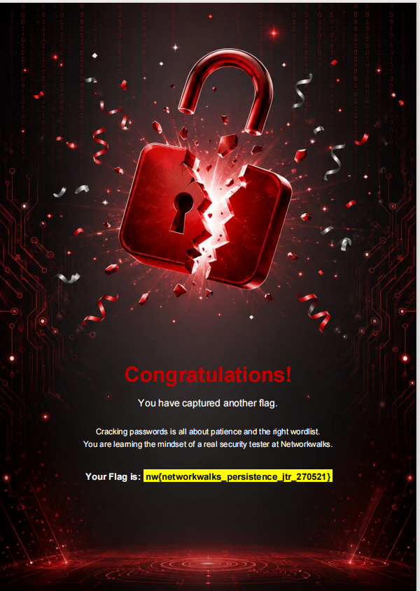
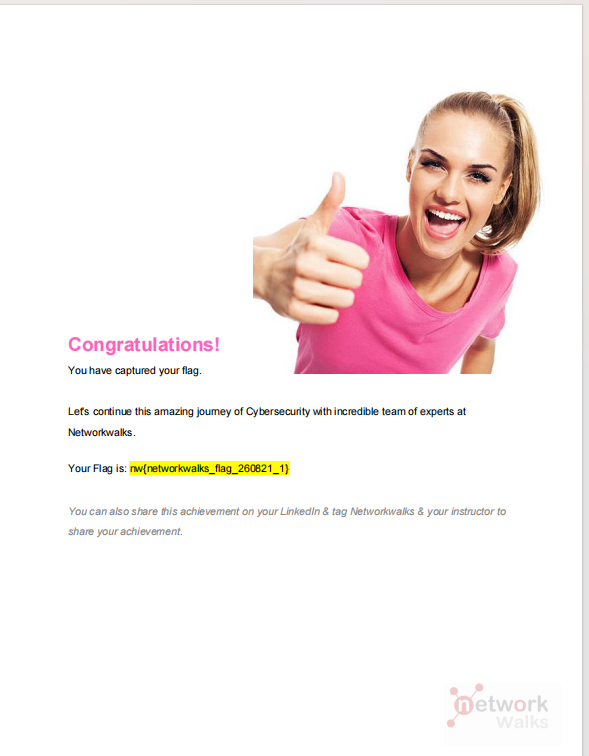
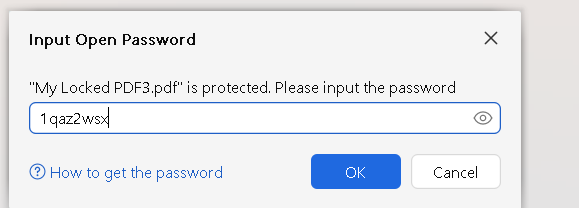
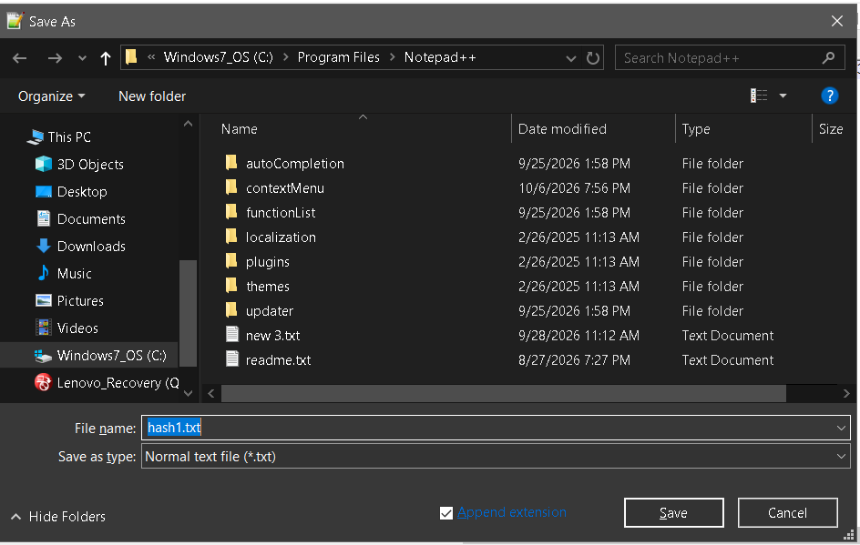
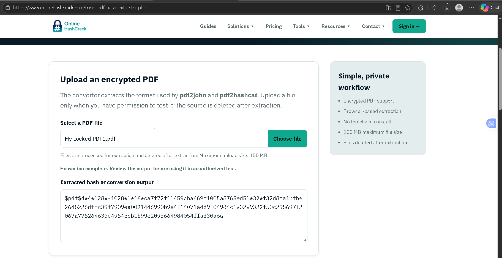
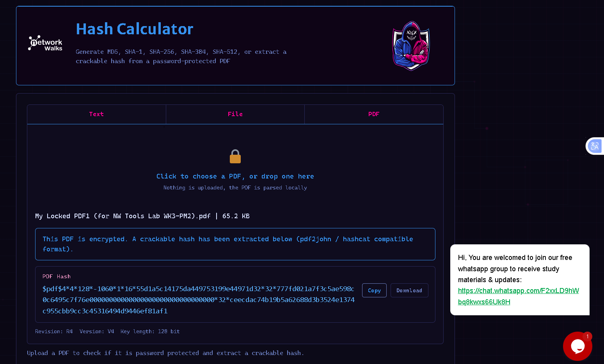
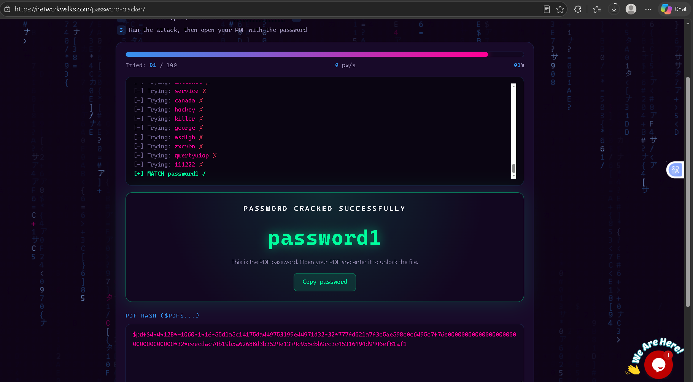

# Password Cracking with JohntheRipper(JTR/GUI/CLI) and NetworkWalks Hash Calculator Password Cracker
🔐 Week 3 –> Project Modules 1 &amp; 2: Password Cracking with John the Ripper (JTR, GUI + CLI) and NetworkWalks Hash Calculator &amp; Password Cracker. Extracted a $pdf$ hash from a protected PDF and recovered the password using dictionary attacks. Educational lab writeup for Cybersecurity &amp; Ethical Hacking.

## 📌 Overview

This repository documents the completion of **Week 3 – Project Modules 1 & 2** from the NetworkWalks Cybersecurity & Ethical Hacking training program. The objective was to recover the password of a protected PDF file (`My Locked PDFs.pdf`) using two different approaches:

| Module | Tools Used | Attack Method |
|--------|-----------|---------------|
| **Module 1** | John the Ripper (Johnny GUI / John CLI) | Dictionary attack on extracted `$pdf$` hash |
| **Module 2** | NetworkWalks Hash Calculator + Password Cracker | Browser-based dictionary attack |

Both labs demonstrate **why weak passwords are dangerous** and how password protected files can be compromised when the password is short or commonly used.

## 🧠 Background Concepts

- **Password cracking** is the process of recovering a password from stored data or a protected file.
- When a file (PDF, ZIP, Office) is locked, the password is represented as a **hash**, a scrambled, one-way value.
- To recover the password, the hash must first be **extracted** from the file, then fed into a cracking tool that tries candidate words until a match is found.
- **Encryption** is a two-way function (encrypt ↔ decrypt with a key), whereas **hashing** is a one-way function used to validate integrity.

 💡 Fact from the lab: An 8-character lowercase-only password can be cracked in minutes, while a strong 12-character mixed password can take many years. Over **24 billion** username/password pairs circulate on the dark web.

## 🛠️ Lab Environment

- **OS:** Windows 10 
- **Target file:** `My Locked PDFs.pdf` (encrypted, Rev 04, 128-bit key length)
- **Tools:**
  - [John the Ripper](https://www.openwall.com/john/) (JtR 1.9.0-jumbo-1 win64)
  - [Johnny GUI](https://openwall.info/wiki/john/johnny) (v2.2)
  - [NetworkWalks Hash Calculator](https://networkwalks.com/hash-calculator/)
  - [NetworkWalks Password Cracker](https://networkwalks.com/password-cracker/)
  - [OnlineHashCrack PDF Hash Extractor](https://www.onlinehashcrack.com/tools-pdf-hash-extractor.php)

## 🔬 Module 1 – Password Cracking with John the Ripper (JTR)

### Step-by-step

1. **Installed John the Ripper** from the official Openwall website (jumbo 1.9.0 Windows build).
2. **Installed Johnny GUI** (Johnny 2.2) and pointed it to `john.exe`
3. 
4. 

 **Extracted the PDF hash** using the OnlineHashCrack PDF Hash Extractor:
- Uploaded `My Locked PDF1-3.pdf` → received a hash in the format `$pdf$4*4*128*...`
4. **Saved the hash** into `hash1-3.txt` inside Notepad.
5. **Opened Johnny → Open password file → `hash1-3.txt`**.
6. **Started the attack** (default John dictionary/wordlist mode).
7. **Recovered the password successfully.**
8. **Opened the PDF** with the cracked password and confirmed access, the PDF displayed the *"Congratulations! You have captured your flag."* page.
  
  

### ResultS
> ✅ PDF password successfully cracked using **John the Ripper / Johnny**, and the protected document was unlocked.
> 
> 
> 
> 
> 

## 🌐 Module 2- Password Cracking with NetworkWalks Tools

### Step by step

1. **Downloaded** the encrypted `My Locked PDF1.pdf` from the NetworkWalks lab page.
2. **Opened the Hash Calculator** → https://networkwalks.com/hash-calculator/
3. **Uploaded the PDF** to the `PDF` tab. The tool read the file and output a crackable hash in **PDF2John / Hashcat-compatible format**, beginning with `$pdf$4*4*128*...`.
4. **Copied the full hash** (important to copy the complete string from `$pdf$` onward).
5. **Opened the Password Cracker** → https://networkwalks.com/password-cracker/
6. **Pasted the hash** and launched the dictionary attack with the built-in **300-word wordlist**.
7. **Waited for the attack to finish** (81/100 tried, ~9 pw/s). The tool reported:

8. 
9. 
10. 
11. 
